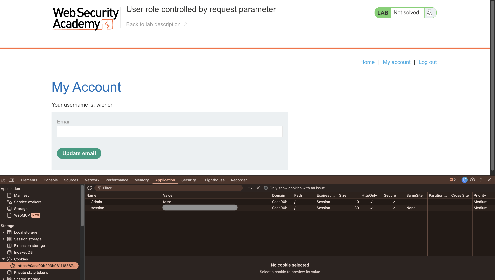
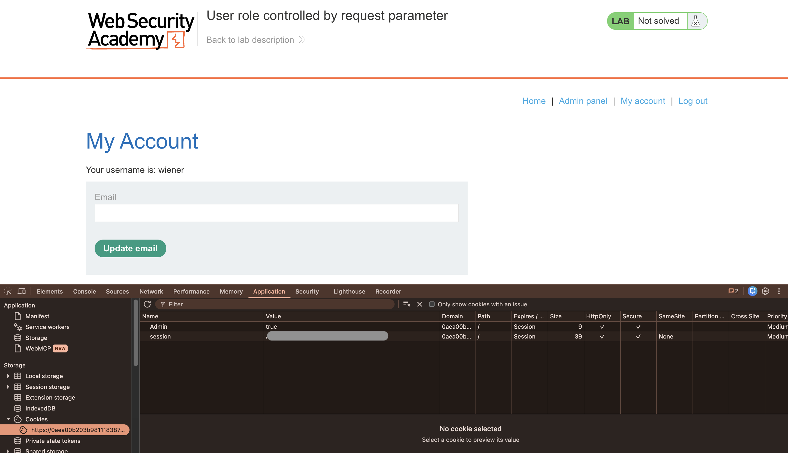
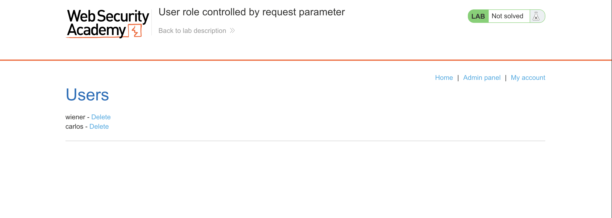
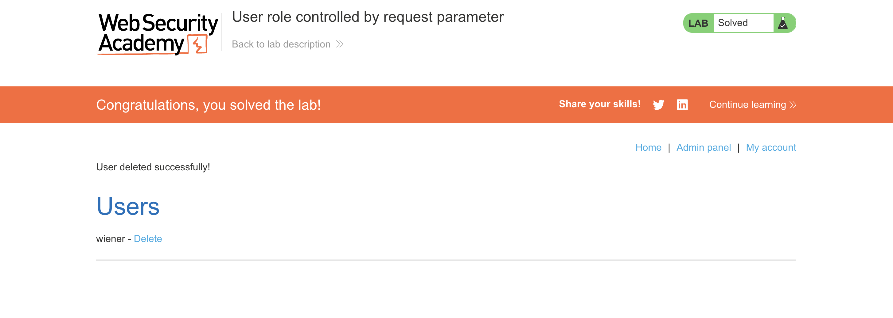

# Lab 03: User role controlled by request parameter

Difficulty: Apprentice\
Lab URL: https://portswigger.net/web-security/learning-paths/server-side-vulnerabilities-apprentice/access-control-apprentice/access-control/lab-user-role-controlled-by-request-parameter \
Vulnerability: Broken Access Control (CWE-863 — Incorrect Authorization)\
Tools: Chrome Developer Tools\
Status: Solved

## Lab Description
This lab has an admin panel at `/admin`, which identifies administrators using a forgeable cookie.

Solve the lab by accessing the admin panel and using it to delete the user `carlos`.

You can log in to your own account using the following credentials: `wiener:peter`

## Discovery and Exploitation
1. I logged into the application as `wiener` using the provided credentials.
2. From there, I opened Chrome Dev Tools and navigated to the Application tab → Storage → Cookies, where I found Admin cookie set to `false`, indicating that the logged in user (wiener) is not identified as an Administrator.

3. I set the Admin cookie from `false` to `true`, pressed Enter to save the change, and refreshed the page. The Admin panel link now appeared in the navigation menu.

4. I clicked on the Admin panel link which displayed a short list of users and the option to delete their accounts.

5. I deleted the user `carlos` and the application displayed a message confirming the successful deletion.

## Root Cause and Impact
The application relied on a user-controlled Admin cookie to determine administrator privileges without validating the user's actual role on the server. By changing the cookie from `false` to `true`, a standard user could escalate their privileges, gain unauthorized access to the admin panel, and perform administrative actions such as deleting user accounts.

## Recommended Remediation
- The application should enforce server-side authorization to verify user roles and permissions rather than relying on user-controlled cookies.
- The application should implement role-based access control (RBAC) to restrict access to `/admin` and sensitive operations, such as deleting user accounts or granting administrator privileges.
- Access control testing should be performed to ensure that modiyfing cookies or other HTTP request parameters cannot lead to unauthorized access or privilege escalation.

## Key Takeaway
- This lab showed why applications should not rely on user-controlled request parameters to determine access privileges, as doing so can lead to privilege escalation. Changing the Admin cookie from false to true was enough to gain unauthorized access to the admin panel and delete another user's account. This reinforces the importance of enforcing server-side authorization checks instead of trusting values that users can modify.