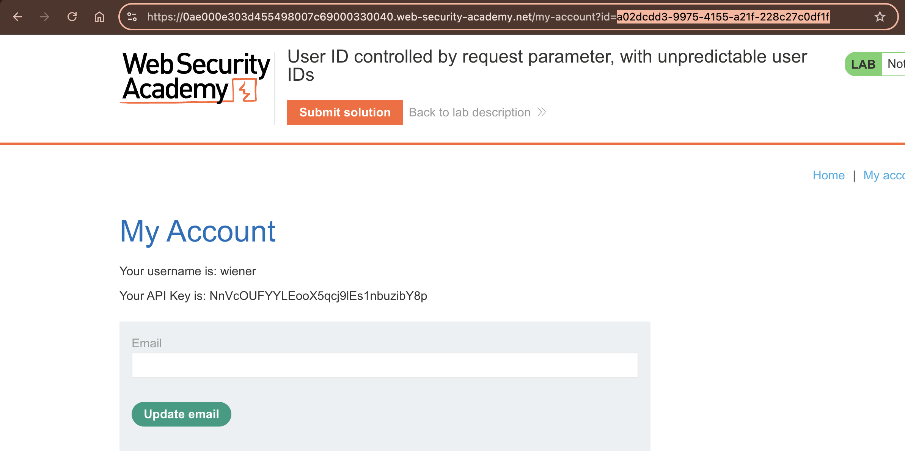
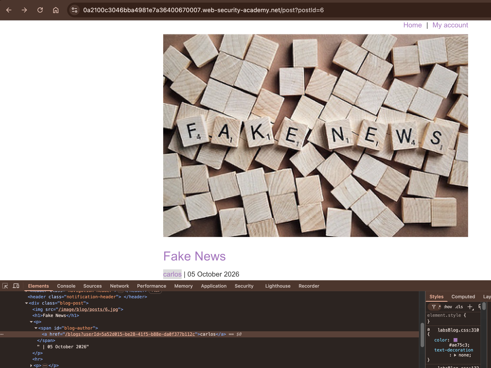
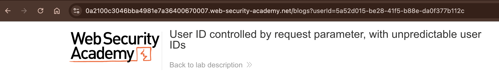
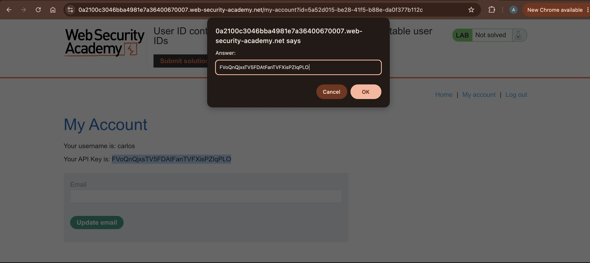

# Lab 04: User ID controlled by request parameter, with unpredictable user IDs

Difficulty: Apprentice\
Lab URL: https://portswigger.net/web-security/access-control/lab-user-id-controlled-by-request-parameter-with-unpredictable-user-ids \
Vulnerability: Broken Access Control — Horizontal Privilege Escalation / IDOR (CWE-639) \
Tools: Chrome Web Browser \
Status: Solved

## Lab Description
This lab has a horizontal privilege escalation vulnerability on the user account page, but identifies users with GUIDs.
To solve the lab, find the GUID for `carlos`, then submit his API key as the solution.
You can log in to your own account using the following credentials: `wiener:peter`

## Discovery and Exploitation
1. I logged into the application as `wiener` using the provided credentials. On the My account page, I could see user `weiner` 's API key and GUID (`a02dcdd3-9975-4155-a21f-228c27c0df1f`) in the browser URL.

2. Then I navigated to the Home page and found a blog post written by user `carlos`. Clicking his username revealed his GUID (`5a52d015-be28-41f5-b88e-da0f377b112c`) in the browser URL.

3. I returned to My account and replaced the `id` parameter in the URL with `carlos`'s GUID. I pressed Enter to submit the modified request.
4. The page reloaded and displayed `carlos`'s account information, including his API key, even though I was still authenticated as wiener. This confirmed a horizontal privilege escalation vulnerability caused by missing object-level authorization checks.

## Root Cause and Impact
The application relied on a user-controlled `id` parameter without validating whether the authenticated user had permission to access the requested account. This allowed for horizontal privilege escalation through an Insecure Direct Object Reference (IDOR) vulnerability.

By replacing user `wiener`'s GUID with user `carlos`'s GUID, I was able to access his account while still logged in as user `wiener`. This exposed sensitive information, including his API key, which could potentially be used to perform unauthorized API requests.

## Recommended Remediation
- The application should enforce server-side authorization to ensure users can only access account information they have permission to view.

- Implement object-level authorization checks to verify account ownership before returning sensitive information, such as API keys.

- Perform access control testing to confirm that modifying GUIDs or other request parameters cannot lead to unauthorized access.

## Key Takeaway
This lab showed that using unpredictable GUIDs alone does not prevent unauthorized access. Even though `carlos` had a unique GUID, I was able to find it through a public blog post and use it to access his account. This highlights why applications need to enforce server-side authorization rather than relying on GUIDs to prevent horizontal privilege escalation.