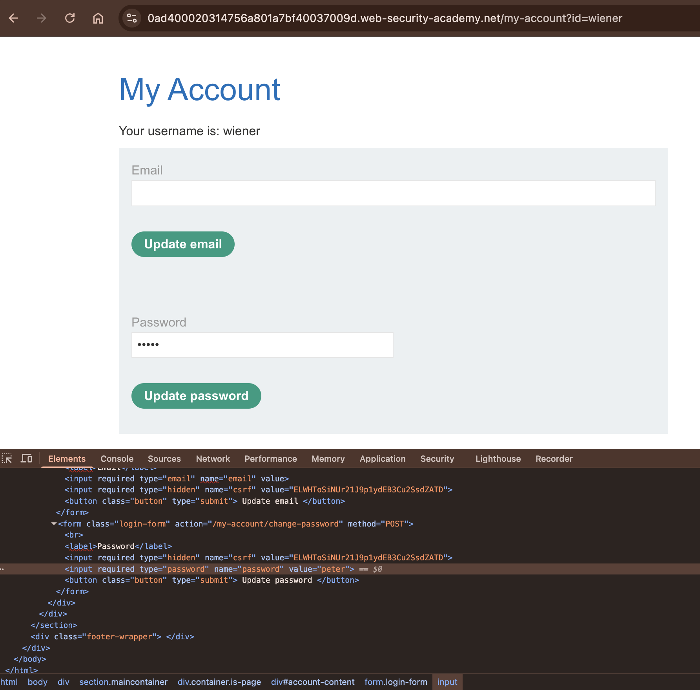
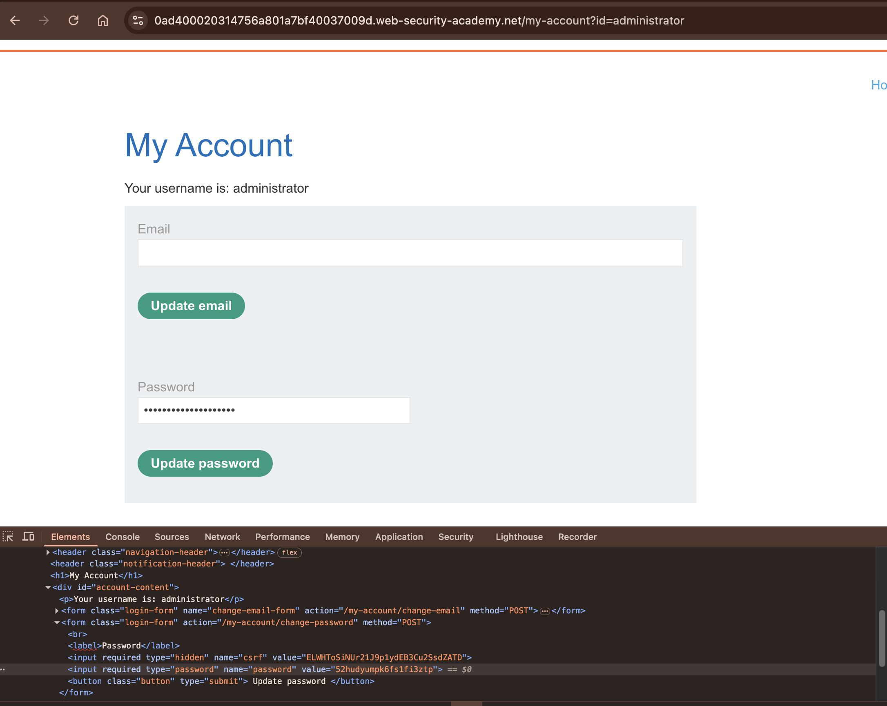
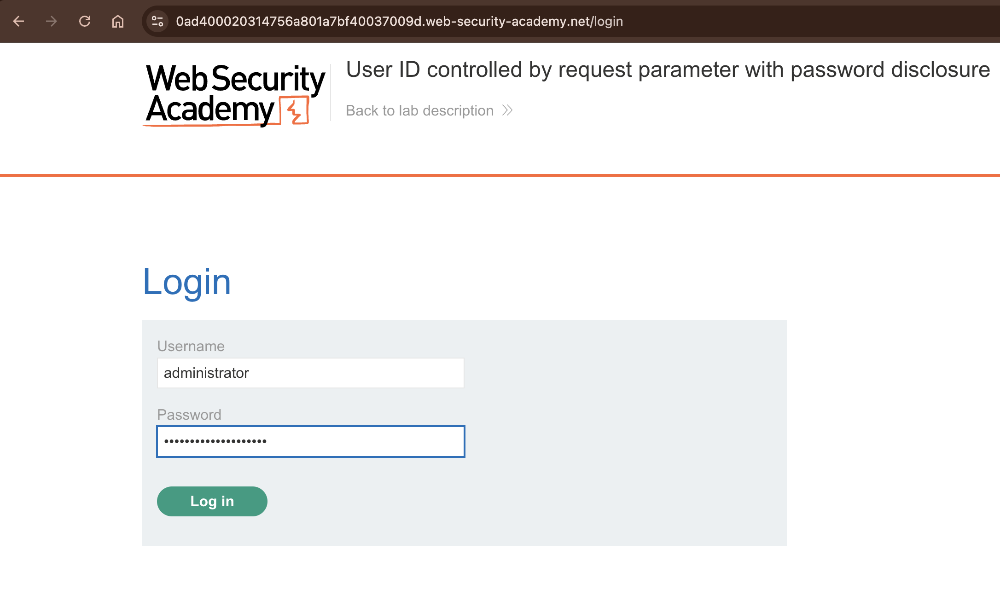
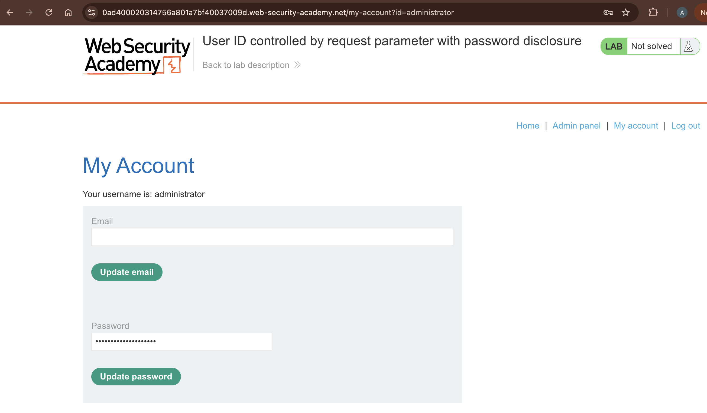
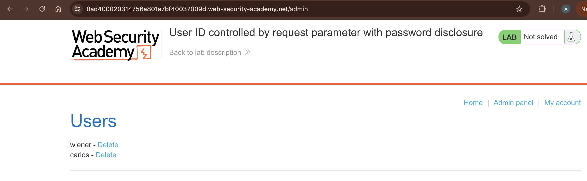
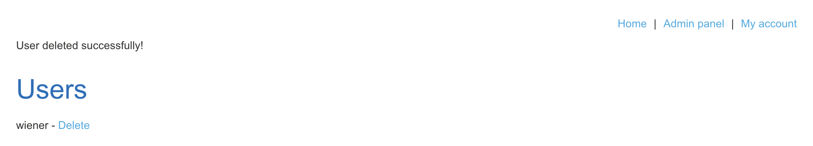

# Lab 05: User ID controlled by request parameter with password disclosure

Difficulty: Apprentice\
Lab URL: https://portswigger.net/web-security/learning-paths/server-side-vulnerabilities-apprentice/access-control-apprentice/access-control/lab-user-id-controlled-by-request-parameter-with-password-disclosure# \
Vulnerability: Broken Access Control (IDOR), Sensitive Information Disclosure
Tools: Google Chrome, Chrome Developer Tools
Status: Solved

## Lab Description
This lab has user account page that contains the current user's existing password, prefilled in a masked input.
To solve the lab, retrieve the administrator's password, then use it to delete the user carlos.
You can log in to your own account using the following credentials: wiener:peter

## Discovery and Exploitation
1. I logged into the application as user `wiener` using the provided credentials. On the My account page, I noticed that the user password field was prefilled and masked. However, when I opened Chrome Developer Tools and inspected the HTML under the Elements tab, I found that the password was exposed in plaintext in the `value` attribute.

2. While still logged in as `wiener`, I guessed the administrator's username and changed the `id` parameter in the URL from `wiener` to `administrator`.
- Original URL:
`https://0ad400020314756a801a7bf40037009d.web-security-academy.net/my-account?id=wiener`

- Modified URL:
`https://0ad400020314756a801a7bf40037009d.web-security-academy.net/my-account?id=administrator`

3. The application loaded the administrator's account page even though I was still logged in as `wiener`. This confirmed an IDOR vulnerability because the application wasn't properly checking whether I was authorized to access another user's account.

4. Since I had already discovered that `wiener`'s password was exposed in the HTML, I opened Chrome Developer Tools again and inspected the administrator's password field. I was able to retrieve the administrator's plaintext password from the `value` attribute.

5. I recorded the administrator's password and logged out of `wiener`'s account. Using the administrator's credentials, I successfully authenticated as `administrator`.

6. Once logged in as `administrator`, I navigated to the Admin panel and deleted the user `carlos`.

## Root Cause and Impact
- Missing server-side authorization checks allowed users to access other accounts by modifying the `id` parameter in the URL.
- The application exposed plaintext passwords in the HTML `value` attribute, making sensitive credentials accessible through browser Developer Tools.
- The IDOR vulnerability allowed an authenticated user to access another user's account information without authorization.
- Exposure of the administrator's password allowed an attacker to compromise a privileged account and achieve vertical privilege escalation.
- With administrator privileges, an attacker could perform unauthorized administrative actions, such as deleting user accounts.

## Recommended Remediation
- Enforce server-side authorization checks to ensure users can only access accounts and resources they are authorized to view.
- Stop exposing plaintext passwords in HTML responses.
- Perform remediation validation after implementing the fixes to verify that unauthorized account access and password disclosure are no longer possible.

## Key Takeaway
This lab demonstrated how multiple vulnerabilities within an application can be chained together to achieve vertical privilege escalation. By exploiting an IDOR vulnerability, I was able to access the administrator's account page, where I discovered that their plaintext password was exposed in the HTML. I then used the credentials to authenticate as the administrator and perform privileged actions. This reinforces the importance of enforcing server-side authorization checks and protecting sensitive credentials from exposure.

/****EDIT****/
These vulnerabilities also created opportunities for further exploitation. By chaining the IDOR vulnerability with sensitive information disclosure, I was able to compromise the administrator's account and achieve vertical privilege escalation.